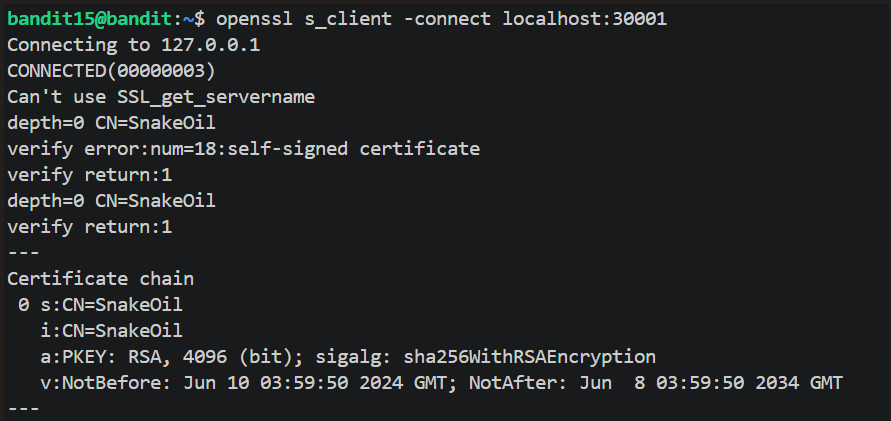

# Level 15 SSL/TLS Protocol

## Overview

Level 15 required connecting to a service over an encrypted channel.

## Walkthrough

Spoiler

As usual you will start by connecting to the bandit server via SSH with the required password. I then used the openssl tool (from the OpenSSL library, which implements the TLS protocol — it is not itself a protocol) to act as a TLS client:

## Commands

Spoiler

|**Commands**|**Purpose**|
|---|---|
|`openssl s_client -connect localhost:30001`|Initiate an encrypted TLS communication.|

