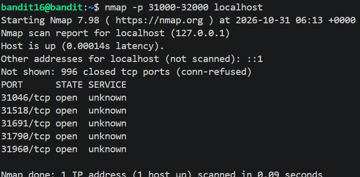
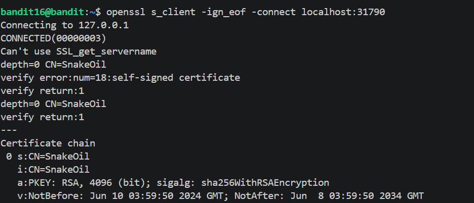

# Level 16 Port Scan

## Overview

Level 16 requires performing a port scan and connect to a listening server
that speak SSL/TLS.

## Walkthrough

Spoiler

- *Start by connecting to the server using SSH credentials, then Scan on localhost for open ports in the range 31000 to 32000.*

- *Investigate the port speaking SSL/TLS. At the end an SSH Private-Key is generated.*

## Commands

Spoiler

|**Commands**|**Purpose**|
|---|---|
|`nmap -p T:31000-32000 localhost`|Scan for open ports|
|`Openssl s_client -ign_eof -connect localhost:port`|Connect to an encryped channel|

