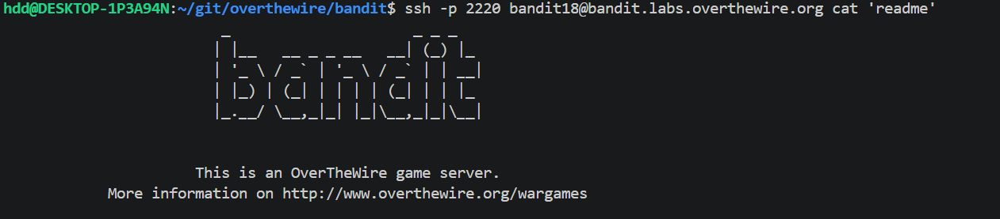

# Level 18 Non-Interactive command execution

## Overview

Level 18 goal was to interact with the server, without using the server's interactive terminal.

This could be achieved by passing commands directly on SSH.

## Walkthrough

Spoiler

Use SSH as usual, but this time, you need to append the command execute at the tail of the ssh command.

## Commands

Spoiler

|**Commands**|**Purpose**|
|---|---|
|`ssh -p 'port' user@hostname cat 'filename'`|non-interactive command execution|

