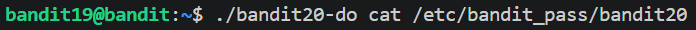

# Level 19 Elevated permission

## Overview

Level 19 required executing a text file from another owner, by using the setuid binary in the home folder.
This granted us "rwx" permission same as the owner of Level 20.
Meaning we could run files that he's owner of.

## Walkthrough

Spoiler

Execute the setuid binary to elevate permission, and append the file path you want to view/run.

## Commands

Spoiler

|**Commands**|**Purpose**|
|---|---|
|`./setuid-do cat /etc/bandit_pass/filename`|Grants elevated permission to run files.|

